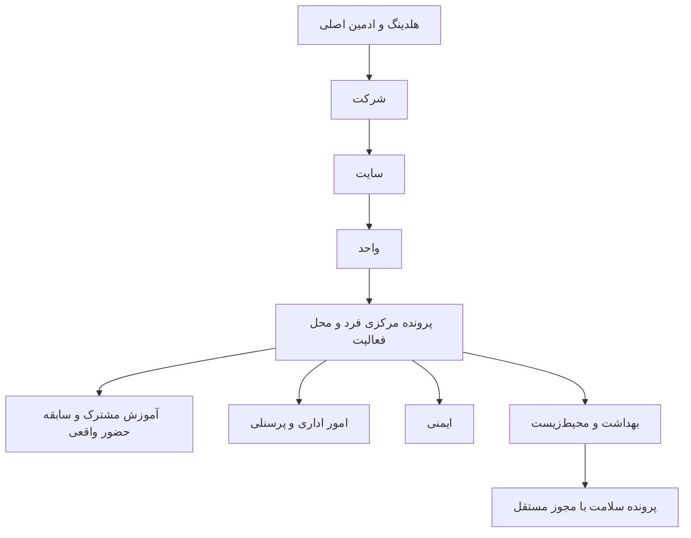

# توسعه Nikan HRM — ۱۴۰۵/۰۸/۲۱

## دامنه تأییدشده

این سامانه ابزار مدیریت منابع انسانی، رؤسای واحدهای اداری، آموزش و HSE شرکت‌های هلدینگ است. مطابق توضیح تکمیلی کارفرما، **ورود کارکنان، کارتابل شخصی و ثبت درخواست توسط کارکنان در دامنه نیست**. مرخصی، وام، رفاهیات و رزرو به عنوان سوابق پرسنل توسط کاربران مدیریتی ثبت می‌شوند.

## مبنای واقعی و تحلیل مرحله اول

شاخه اولیه محیط فقط اکسل و لوگو داشت. سورس آموزش نسخه `v0.10.0` از همان مخزن بازیابی و با سورس بارگذاری‌شده `NikanTraining-0.11.2-Source.zip` در commit `6a98f062` مقایسه شد. نسخه جدیدتر، گردش تصمیم نیاز آموزشی، برنامه توسعه، اولویت ارزیابی جاری و بازیابی امن حساب را اضافه می‌کند؛ این امکانات حفظ می‌شوند. ردگیری دقیق در `hrm-source-baseline.json` است.

هسته Flask، رابط JavaScript فارسی، SQLite محلی روی سرور با WAL و تراکنش و پشتیبان‌گیری موجود مناسب توسعه فعلی‌اند. پایگاه روی پوشه مشترک SMB قرار نمی‌گیرد. سرویس یا چارچوب اینترنتی تازه اضافه نمی‌شود. سرور HTTPS و پشتیبان رمزگذاری‌شده قبلی در کنار اصلاحات جدید نگه داشته می‌شوند. اندازه واقعی بار و سیاست نگهداری اطلاعات باید در استقرار سازمان آزموده شود.

پرسنل همان شناسه موجود در `employees` را دارند؛ هیچ بانک کارکنان موازی ساخته نمی‌شود. جزئیات و انتصاب جاری HRM به صورت یک‌به‌یک اضافه می‌شوند. انتقال جاری بین شرکت‌ها با کنترل هر دو شرکت و تاریخچه اجرا می‌شود؛ مالکیت سوابق آموزش قبلی و شماره‌های قراردادی بازنویسی نمی‌شود. مجوز خواندن هر سابقه محرمانه علاوه بر شخص، شرکت مالک همان سابقه را هم کنترل می‌کند.

## ساختار اجراشده و مراحل تحویل

| مرحله | نتیجه و بررسی |
| --- | --- |
| ۱. شناخت و حفاظت | مبنای واقعی ۰٫۱۰ و ۰٫۱۱٫۲ ثبت شد؛ workbook، شناسه مرکزی و امکانات آموزش حفظ شدند. |
| ۲. ساختار داده | شرکت/سایت/واحد، انتساب جاری، انتقال و فعالیت موقت اضافه شدند؛ سوابق موجود مالک تاریخی خود را حفظ می‌کنند. مهاجرت دو نسخه و پشتیبان پیش از ارتقا بررسی شدند. |
| ۳. دسترسی | ادمین کامل و مدیران واگذارشده، محدوده چند شرکت/سایت/واحد و پنج عملیات مستقل؛ آزمون مسیر مستقیم API، مدارک محرمانه، خروجی و حساب‌های قدیمی. |
| ۴. عملیات | پرونده، قرارداد، حضور، عملکرد، انضباط، وام/خدمات/اقامت، ایمنی/PPE و بهداشت و محیط‌زیست؛ فرم، اعتبارسنجی، نسخه و رویداد؛ بدون ورود کارکنان. |
| ۵. گزارش | چهار داشبورد و تجمیع ادمین، مقایسه شرکت/سایت، فیلتر و Excel مجاز، هشدارهای مبتنی بر داده، عدم جایگزینی داده تنظیم‌نشده با صفر سالم. |
| ۶. پایداری | تراکنش و نسخه‌گذاری، ابطال و تاریخچه، مدارک خصوصی، حفاظت API و بازیابی معتبر؛ آزمون یکپارچه، مرورگر و payload نصب. |
| ۷. استقرار | نصاب آزمایشی با پروفایل مستقل، نصاب سرور با مسیر ارتقای قبلی، کلاینت میانبر، manifest و checksum و سورس؛ تأیید بومی Windows فقط با نتیجه مشاهده‌شده workflow. |

تاریخ جدید HRM به ISO ذخیره و به شمسی دریافت/نمایش داده می‌شود. تاریخ‌های قبلی آموزش مخرب بازنویسی نمی‌شوند. نتیجه اجرای جاری و حدود عملیاتی در [validation-0.12.md](validation-0.12.md) ثبت شده است.

## قواعد مشترک

- نقش‌های آموزش قدیمی و امکانات تقویم، بانک، اکسل، شناسنامه، تعهدنامه A4 و تسهیم هزینه حفظ می‌شوند.
- نقش‌های مدیریتی HRM: مدیر سیستم، منابع انسانی هلدینگ، منابع انسانی شرکت، رئیس واحد، مسئول آموزش، مسئول HSE و مدیریت ارشد. نقش کارمند و ثبت درخواست وجود ندارد.
- ادمین اصلی طبق دستور نهایی به تمام بخش‌ها و اسناد دسترسی کامل دارد. برای سایر کاربران، قرارداد، مدارک، انضباط، وام و سلامت مجوزهای مستقل دارند. تغییر مجوزها ثبت رویداد می‌شود.
- کاربران محدود HRM با مراجعه مستقیم به API قدیمی آموزش یا Excel به فهرست گسترده پرسنل دسترسی پیدا نمی‌کنند.
- خروجی کامل پایگاه و کلید بازیابی فقط در اختیار ادمین اصلی است؛ مدیران واگذارشده نمی‌توانند از آن برای عبور از محدوده ماژول و سایت استفاده کنند.
- اطلاعات مالی بر حسب ریال صحیح، به‌روزرسانی حساس با شماره نسخه، رزرو و محدودیت خدمات در تراکنش قفل‌شده بررسی می‌شوند.
- سیاست قانونی مرخصی، سقف و دفعات وام، سهمیه رفاهیات یا دوره تجدید PPE بدون تنظیم سازمان فرض نمی‌شود.
- مدارک خصوصی در پایگاه و در پشتیبان موجود ذخیره می‌شوند؛ نشانی فایل عمومی برای آن‌ها ایجاد نمی‌شود.
- سورس، گزارش و بسته‌های نهایی در همین مخزن و شاخه `nikan-hrm` ثبت می‌شوند؛ برچسب‌های نسخه‌های قبلی جابه‌جا نمی‌شوند.
