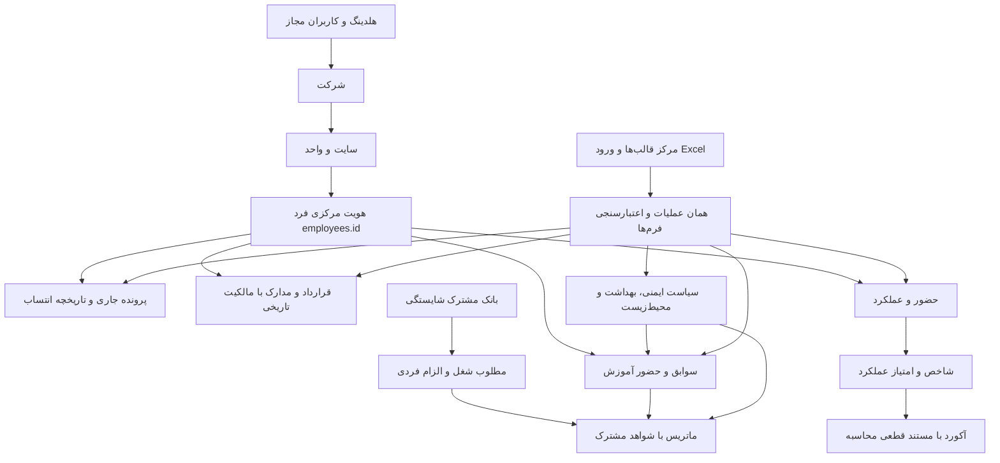

# مرجع ارتباط بخش‌های Nikan HRM

`personnel_identity` مرجع تطبیق کد/فرد و ویرایش هویت در مسیرهای سازگار قدیمی است؛ تطبیق فازی نام یا ادغام خودکار اشخاص ندارد. `hrm_integration` فقط نمای مجاز روی داده‌های موجود است و جدول یا پرونده دوم نمی‌سازد. هویت تاریخی، جایگاه فعلی خارج از مجوز را آشکار نمی‌کند.

`hrm_training_evidence` مرجع ترتیب شواهد و حضور واقعی، و `hrm_matrix` مرجع محاسبه ماتریس است. داده ناپیدا یا تعیین‌نشده با صفر پر نمی‌شود. `hrm_productivity` از دوره/شاخص/امتیاز موجود عملکرد استفاده و نتیجه قطعی را به صورت مستند غیرقابل بازنویسی نگه می‌دارد.

`hrm_excel` منطق نوشتن بانک دوم ندارد. درخواست داخلی محدودشده به مسیرهای شناخته‌شده، با همان کاربر، CSRF و اتصال پایگاه، عملیات اصلی را اجرا می‌کند. state درخواست و مجوز مرجع بعد از هر فراخوانی بازگردانده می‌شود. savepointهای دامنه داخل تراکنش فایل قرار دارند و COMMIT/ROLLBACK خارج از آن مجاز نیست. مدرک باینری و رمز کاربر از Excel جعل یا بارگذاری نمی‌شوند.

شناسه مشترک، به معنی یکسان‌کردن مالکیت جاری و تاریخی یا مجوز همه بخش‌ها نیست. هر بخش، مجوز مستقل و دامنه رکورد خودش را نگه می‌دارد؛ اطلاعات سلامت، وام، قرارداد و آکورد به‌صرف مشاهده نام فرد آزاد نمی‌شوند.
